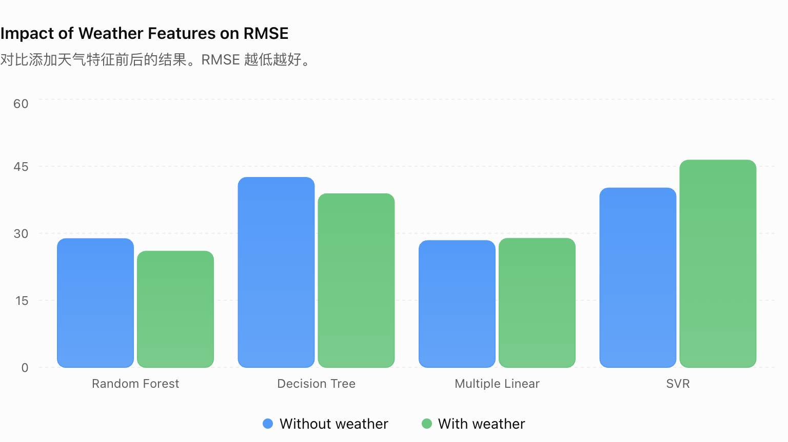
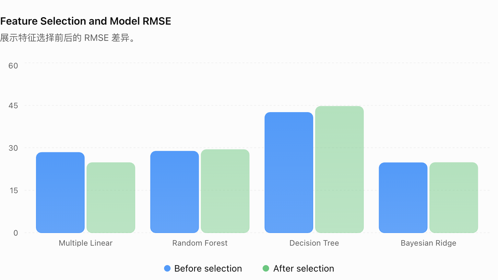
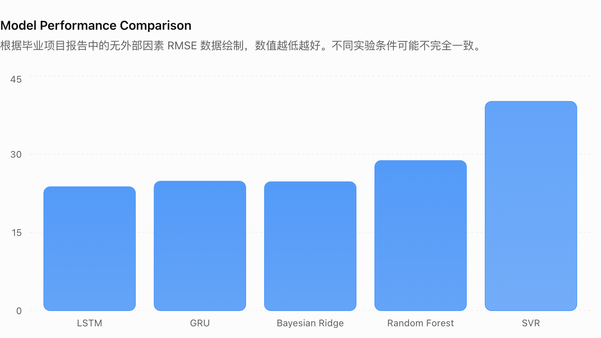

# Healthcare Resource Forecasting

**Master’s computer science project | University of Kansas**

## Machine Learning Pipeline
Healthcare Historical Data
          |
          v
Data Cleaning & Exploration
          |
          v
Feature Engineering
          |
          v
Feature Selection
          |
          v
Machine Learning Models
          |
          v
RMSE-based Evaluation

## Tech Stack

- Programming: Python
- Data Processing: pandas, NumPy
- Machine Learning: scikit-learn
- Time-series Modeling: statsmodels
- Deep Learning: TensorFlow/Keras
- Visualization: Matplotlib, Seaborn

The project investigates healthcare resource forecasting through classical machine learning models and deep learning time-series approaches.

Exploratory machine learning and time-series experiments to study hospital resource utilization, with an emphasis on predicting **`ICU Beds in Use - Total`**. The original project compares multiple forecasting approaches and investigates the effects of weather-related features and other healthcare variables.

> **Project status:** Archived academic experiments. These scripts have been preserved substantially as originally authored; they have **not** been validated as a reproducible end-to-end package or a production forecasting service.

## Research questions

- How do classical regression and time-series models compare when modeling ICU bed usage?
- How does the evaluation change between a random split and a chronological split?
- Do weather-related variables consistently improve forecasting error across model families?
- What is the effect of feature selection on different regression models?

## Repository contents

| Folder | Contents |
| --- | --- |
| `data_analysis/` | Exploratory data analysis, autocorrelation analysis, and feature-selection experiments |
| `regression_models/` | Regression experiments under random split and chronological split settings |
| `time_series_models/` | ARIMA, SARIMA, EWMA, LSTM, GRU and other forecasting models |
| `external_features/` | Experiments incorporating external variables such as weather-related features |
| `Dataset/` | Project datasets and intermediate files |
| `Test_dataset/` | Data cleaning and testing utilities |

The original script names and relative folder layout have been retained to preserve the history of the project. Some scripts expect local data paths and will need path adjustments depending on the working directory.

## Models and Methods

### Classical Machine Learning

- Linear Regression
- Multiple Linear Regression
- Ridge Regression
- LASSO Regression
- Bayesian Ridge
- Support Vector Regression
- Decision Tree
- Random Forest


### Deep Learning

- LSTM
- GRU


### Time-series Models

- ARIMA
- SARIMA
- EWMA
- Dynamic Regression

The project includes experiments with linear and polynomial regression, Ridge, Lasso, Bayesian Ridge, support vector regression, decision trees, random forests, ARIMA/SARIMA, exponential smoothing, LSTM, and GRU. The scripts use Python libraries including pandas, NumPy, scikit-learn, statsmodels, Matplotlib, Seaborn, and Keras/TensorFlow.

The exploratory preprocessing scripts examine missing-value handling, IQR-based outlier filtering, invalid negative values, and ICU capacity constraints. **These steps do not describe every experiment's pipeline:** the weather-enhanced, time-series, and feature-selection scripts differ.

## Selected results from the original project report

The following values were transcribed from the author's project-summary material, **not regenerated by running this repository**. RMSE values should only be compared where the target, data split, forecasting horizon and evaluation setup match.

| Experiment | Model | Baseline RMSE | Modified RMSE |
| --- | --- | ---: | ---: |
| Added weather features | Random Forest | 28.77 | 25.96 |
| Added weather features | Decision Tree | 42.48 | 38.83 |
| Added weather features | Multiple Linear Regression | 28.33 | 28.83 |
| Feature-selection condition | Multiple Linear Regression | 28.33 | 24.73 |
| Added disease-related factors | Support Vector Regression | 40.10 | 31.38 |
| Added disease-related factors | GRU | 24.80 | 23.99 |
| Added disease-related factors | LSTM | 23.73 | 24.43 |

The results demonstrate **mixed effects** rather than a universal advantage from adding external features. The table does not establish a single best-performing model across all experimental settings.

## Key Findings

| Experiment | Observation |
|---|---|
| Weather features | Improved Random Forest and Decision Tree performance |
| Feature selection | Reduced Multiple Linear Regression RMSE from 28.33 to 24.73 |
| Disease-related factors | Improved SVR and GRU performance but not all models |
| Model comparison | Different models responded differently to external features |

## Results Visualization

### Weather Feature Impact




### Feature Selection




### Model Performance



## Running the archived experiments

1. Create a Python virtual environment and install the libraries listed in `requirements.txt`.
2. Open the relevant `.py` file and check its data path, feature columns, and working-directory assumptions.
3. Run individual experiments from their respective directories when their required input files are present.

```bash
python3 -m venv .venv
source .venv/bin/activate
pip install -r requirements.txt
```

No single consolidated command is provided: the original deliverable consists of separate research scripts rather than a packaged training application. Exact historical package versions are not known, and the dependency list is an import-based starting point, not a tested lockfile.

## Data availability and limitations

The approximately 37 MB file `Dataset/COVID-19_Reported_Patient_Impact_and_Hospital_Capacity_by_State_Timeseries__RAW__20240326.csv` is **not included** in this public-ready package. Smaller CSVs included here are project working files; **their redistribution rights and any sensitive-content concerns must be checked before publishing publicly**. If those checks cannot be completed, remove the CSVs and publish code plus instructions to obtain the public source datasets.

This repository documents an academic research project and has known experimental limitations:

- Some earlier experimental scripts may require additional validation to ensure strict separation between feature selection and final evaluation.
- Some neural time-series scripts fit scalers before splitting data; this can expose information from the test period.
- A script being located under `With_Weather/` does not necessarily mean weather variables were included in the model's final input tensors.
- Evaluation protocols and preprocessing are not fully standardized across every experiment; model metrics must not be treated as directly comparable without further review.
- These results have not been independently reproduced in the preparation of this GitHub package.

Future improvements could isolate preprocessing inside training folds, use chronological backtesting, standardize metrics and horizons, and offer a reproducible unified experiment runner.

## Purpose

This repository presents the scope and technical work of an academic machine-learning project and provides supporting code for review. It is not intended for clinical decision-making or real-world hospital resource allocation.

